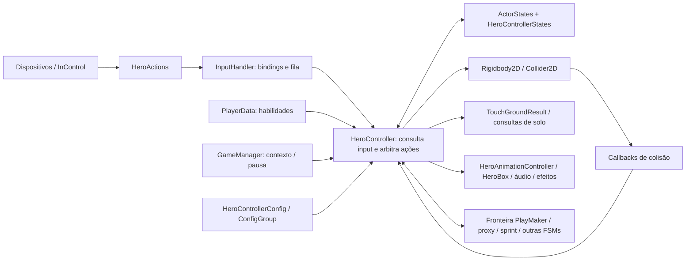

# Controlador: movimento, estados, input e dependências

**OBSERVADO:** leitura estática focalizada da decompilação indexada por [managed.md](../../../reports/latest/managed.md). Caminhos da tabela abaixo são relativos a `.local/decompiled/Assembly-CSharp/`. Não há transcrição de código nem de dados de assets neste documento.

## Mapa de evidências

| ID | Arquivo / localizador | Evidência examinada |
|---|---|---|
| E1 | `HeroActions.cs`, construtor | **OBSERVADO:** ações InControl, eixos compostos, limiares e zonas mortas. |
| E2 | `InputHandler.cs:301`, `Update`; `:370`, `UpdateButtonQueueing`; `:393`, `GetWasButtonPressedQueued` | **OBSERVADO:** atualização de dispositivo/contexto e fila temporizada consumível. |
| E3 | `HeroController.cs:1915`, `Update`; `:8362`, `LookForInput`; `:8564`, `LookForQueueInput`; `:11671`, `FilterInput` | **OBSERVADO:** consulta direta às ações, filtros, bloqueios e despacho. |
| E4 | `HeroController.cs:2968`, `FixedUpdate`; `:3369`, `UpdateMoveInput`; `:3374`, `DoMovement`; `:3921`, `Move`; `:11866`, `GetRunSpeed` | **OBSERVADO:** aplicação de movimento e composição de exceções. |
| E5 | `HeroController.cs:8761`, `HeroJump`; `:3997`, `Jump`; `:9894`, `CancelJump`; `:10301`, `JumpReleased` | **OBSERVADO:** início, sustentação por passos, liberação e limpeza. |
| E6 | `HeroController.cs:10826`, `CanJump`; `:11581`, `OnCollisionExit2D`; `LeftGround` logo após; decremento de `ledgeBufferSteps` em `FixedUpdate` | **OBSERVADO:** janela após perda de chão e consumo na elegibilidade. |
| E7 | `HeroController.cs:11366`, `OnCollisionEnter2D`; `:10257`, `BackOnGround`; `:8994`, `DoHardLanding`; `:10717`, `CheckTouchingGround`; `TouchGroundResult.cs`, `Update` | **OBSERVADO:** contatos, consultas de solo, retorno e recuperação. |
| E8 | `HeroControllerStates.cs`, campos, `Reset`, `GetState`, `SetState`; `GlobalEnums/ActorStates.cs`; `HeroController.cs:9213`, `SetState` | **OBSERVADO:** enum + flags, acesso por nome e sincronização com animação. |
| E9 | `HeroController.cs:10905`, `CanDash`; `:9053`, `HeroDash`; `:4329`, `Dash`; `:10328`, `FinishedDashing`; `BeginWallSlide` | **OBSERVADO:** permissões, interrupções e fronteiras com parede/FSM. |
| E10 | `HeroController.cs:1796`, `UpdateConfig`; `:1829`, `SetConfigGroup`; `HeroControllerConfig.cs`, declaração e propriedades | **OBSERVADO:** grupos de configuração e ScriptableObject. |
| E11 | `PlayerData.cs:257`, `hasDash`; `:263`, `hasDoubleJump`; `GameManager.cs:314`, `GameState`; `PauseGameToggle` | **OBSERVADO:** progressão, contexto global e pausa. Leitura limitada aos campos e pontos de uso. |

## Fluxo e dependências

**OBSERVADO [E1–E4, E8–E11]:** o diagrama representa referências e chamadas vistas nos corpos examinados. Não representa todos os sistemas nem prova que um evento tenha receptor ativo.

**OBSERVADO [E2–E3]:** `InputHandler.PlayingInput` não é um despachante completo de comandos de movimento. O próprio `HeroController.Update` consulta ações em `LookForInput` e `LookForQueueInput`. `HeroActions` define a semântica dos controles; `InputHandler` administra bindings, dispositivos, contexto e uma fila auxiliar.

**INFERIDO [E2–E4]:** existe uma fronteira temporal entre leitura de botões por frame e escrita de movimento por passo físico. As filas ajudam a preservar intenção em transições; a latência real depende do agendamento da Unity.

## Movimento horizontal e controle aéreo

- **OBSERVADO [E3–E4]:** `UpdateMoveInput` consulta o eixo horizontal. No caminho por `LookForInput`, `FilterInput` converte o eixo em negativo, neutro ou positivo. Logo, a existência de um eixo analógico não prova velocidade proporcional nesse caminho.
- **OBSERVADO [E4]:** `Move` preserva a componente vertical e atribui a horizontal a partir da direção e da velocidade selecionada, quando o input está habilitado e não há wall slide. A zona de caminhada só seleciona velocidade de caminhada no chão; `GetRunSpeed` também considera uma condição de modificador temporário.
- **OBSERVADO [E4]:** há bloqueio por lado em inclinações e recuperação de ação que pode zerar a direção. Velocidades extras com decaimento são compostas depois, com regras de aplicação. `DoMovement` sai cedo para dash/backdash e aplica tratamento de recuo em outro ponto.
- **INFERIDO [E3–E4]:** o caminho normal favorece resposta horizontal direta, inclusive no ar quando permitido. Isso não demonstra ausência de inércia ou aceleração em todos os estados: parede, recuo, ações externas e composição de velocidades podem dominar o resultado.
- **HIPÓTESE:** a resposta visual rápida resulta principalmente da atribuição direta de velocidade. Medir input e deslocamento em jogo para distinguir física, animação e atraso de captura.

## Pulo: estudo vertical

1. **OBSERVADO [E3, E5]:** `LookForQueueInput` testa salto de parede, salto normal e alternativas aéreas conforme permissões; se a tentativa falha, pode registrar filas. Não há uma única regra universal de pulo.
2. **OBSERVADO [E5]:** `HeroJump` prepara flags, contadores, apresentação e estado aéreo; cancela ou limpa ações relacionadas em condições específicas. Não é apenas um impulso físico.
3. **OBSERVADO [E4–E5]:** `FixedUpdate` chama `Jump` quando as flags permitem. `Jump` reafirma a componente vertical durante uma janela contada em passos e depois cancela a sustentação.
4. **OBSERVADO [E3, E5]:** soltar o botão leva a `JumpReleased`; a redução da subida depende de mínimo de passos, direção da velocidade e exceções. Há suporte a uma fila de liberação. Não se conclui que a redução ocorre imediatamente em toda soltura.
5. **OBSERVADO [E6]:** `LeftGround` pode armar uma janela de borda após detectar chão no histórico. `CanJump` aceita essa janela sob bloqueios adicionais, inclusive proximidade de teto, e a consome. Essa consulta possui efeito colateral.
6. **INFERIDO [E5–E6]:** há mecanismos equivalentes a altura variável e coyote time. Sua duração em milissegundos não pode ser obtida apenas pelo nome ou quantidade de passos sem confirmar passo físico e condições ativas.

**OBSERVADO [E2–E3, E5]:** distinguir três mecanismos: fila temporizada de botões em `InputHandler`; filas de ações por passos no controlador; janela de borda referente ao chão. `GetWasButtonPressedQueued` aparece, por exemplo, na retomada de controle. Não há evidência de que toda tentativa normal de pulo percorra essa fila auxiliar. A fila normal de pulo exige botão mantido para sua execução posterior; soltura limpa filas relacionadas.

**PROPOSTA GODOT:** preservar a intenção com um único contrato de buffer, explícito e testável. Separar consulta pura de elegibilidade do consumo do comando/janela; assim, consultar debug não modifica a possibilidade de saltar.

## Aterrissagem, colisões e interrupções

- **OBSERVADO [E7]:** callbacks distinguem direção e superfície. Contato superior pode cancelar salto; contato inferior escolhe retorno normal, recuperação especial ou aterrissagem de dash, conforme condições.
- **OBSERVADO [E7]:** `BackOnGround` limpa variáveis de queda, velocidades adicionais e flags; renova disponibilidade aérea. Ações de ataque têm condições próprias de reset. Há proteção contra certos efeitos repetidos de aterrissagem.
- **OBSERVADO [E7]:** `DoHardLanding` interrompe ações, redefine input e entra em recuperação; `Update` usa timer para sair desse estado. A seleção completa do limiar de aterrissagem forte não foi investigada.
- **OBSERVADO [E7]:** `CheckTouchingGround` delega a `TouchGroundResult`; o trecho examinado combina raios, filtro de superfície e atualização condicionada. Chão não depende exclusivamente de um callback.
- **PENDENTE:** geometria, máscaras efetivas de cada instância, material, passo físico e ordem dos contatos. Não se propõe transportar esses testes e tolerâncias diretamente para Godot.

## Estados, parâmetros e fronteira do dash

**OBSERVADO [E8]:** `ActorStates` expressa categorias amplas como idle/running/airborne/recuperação/no_input; `HeroControllerStates` mantém flags simultâneas, contadores e acesso por nome. `SetState` normaliza grounded em idle/running, guarda estado anterior e informa animação. Existem atribuições diretas fora desse método nos trechos examinados; não é uma máquina exclusiva e totalmente centralizada.

**INFERIDO [E8–E10]:** a arquitetura é híbrida. A enumeração sozinha não explica o personagem; flags, configurações, FSMs e controle temporariamente cedido também participam. O controlador concentra política, física, apresentação e integração global, aumentando o custo de entender interrupções.

**OBSERVADO [E4–E5, E9–E10]:** campos do controlador agrupam velocidades de andar/correr, salto, limite de queda, tempos e contadores. `HeroControllerConfig` contém permissões e recuperação de ataques; `ConfigGroup` permite selecionar configurações. Localizar um campo não determina seu valor serializado real nem seu uso em todos os caminhos.

**OBSERVADO [E9, E11]:** dash depende de habilidade, cooldown, uso aéreo e recuperação de ataque, entre outras condições. Sua entrada cancela ações; a atualização possui tratamento próprio de velocidade/gravidade e pode ceder ao wall slide. A saída interage com animação e FSM de sprint. Não há base para tratar dash como prova de invulnerabilidade, nem para equiparar a ação `Evade` a esse mesmo fluxo.

**PENDENTE:** investigação de `Evade`, grafo completo de sprint, animação e todas as permissões de combate foi deliberadamente adiada. A proposta seguinte especifica apenas os contratos necessários para o primeiro controlador independente.
