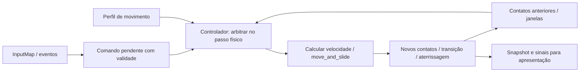

# Proposta independente de controlador para Hack Overdrive

**OBSERVADO — destinatário:** Claude Code executará o trabalho no projeto de destino. Este documento oferece alternativas derivadas do estudo de Silksong; escolhas de engine, linguagem, jogabilidade e implementação ficam sob sua responsabilidade em colaboração com o usuário. Elas não bloqueiam o estudo da referência e não constituem compromissos de implementação deste agente.

**PENDENTE:** o projeto ainda não existe, conforme resposta do usuário. Não há versão ou linguagem configuradas para verificar. Este documento assume condicionalmente Godot 4.x; não escolhe release exata nem fornece implementação. GDScript tipado é uma opção inicial, ainda não aprovada; a divisão funciona também em C#.

**PROPOSTA GODOT:** resolver três problemas: comandos perdidos entre frames e física, múltiplos sistemas escrevendo velocidade e interrupções deixando estado residual. O objetivo é um controlador original ajustável à identidade de Hack Overdrive, sem copiar código, constantes ou catálogo de habilidades de Silksong.

## Estrutura mínima sugerida

**PROPOSTA GODOT:** caminhos abaixo são futuros, relativos a um projeto que ainda será criado. Começar com poucos arquivos; não criar um Node para cada estado.

| Futuro elemento | Responsabilidade |
|---|---|
| `actors/player/player.tscn`: raiz `Player` / `CharacterBody2D`, script `player_controller` | Único dono da velocidade, passo físico, estado e prioridades. |
| Filho `CollisionShape2D` | Forma e tamanho de colisão independentes do sprite. |
| Filho `Visuals` / `Node2D`, sprite e `AnimationPlayer`; script `player_presentation` | Ler estado/eventos e escolher animações, orientação e efeitos. Sem escrita de velocidade. |
| `actors/player/player_input` | Capturar eixo, pressão, soltura e manutenção; armazenar intenção para consumo físico. Pode começar como objeto auxiliar do controlador. |
| `actors/player/movement_profile` / `Resource`, instância `default_movement.tres` | Configuração editável; separar dados de estado transitório. |
| `tests/movement_lab.tscn` e painel opcional de debug | Pista, reprodução de comandos e inspeção de estado/velocidade/timers. Criar apenas na futura etapa autorizada. |

**PROPOSTA GODOT:** `CharacterBody2D` oferece movimento controlado por script e consultas de colisão; usar `velocity`, `move_and_slide`, `is_on_floor` e `is_on_ceiling`. Aplicar gravidade no controlador; não esperar integração automática. Não multiplicar a velocidade por delta antes de `move_and_slide`. Consultas de contato descrevem o movimento resolvido anteriormente. Referência: [CharacterBody2D, documentação oficial](https://docs.godotengine.org/en/stable/classes/class_characterbody2d.html).

**PROPOSTA GODOT:** mapear ações próprias em InputMap: mover esquerda/direita e pular; dash/ataque só quando aprovados. Capturar eventos de pressão e soltura e manter comandos pendentes até o passo físico, evitando perda ou consumo repetido. Referência: [Input e InputMap, documentação oficial](https://docs.godotengine.org/en/stable/tutorials/inputs/input_examples.html).

**PROPOSTA GODOT:** usar Resource para o perfil; instâncias compartilham recursos por padrão, portanto guardar timers e estado no personagem. O debug pode usar uma cópia de perfil por sessão. Referência: [Resources, documentação oficial](https://docs.godotengine.org/en/stable/tutorials/scripting/resources.html).

## Estado e contrato de atualização

**PROPOSTA GODOT:** iniciar com um enum de locomoção `Grounded`, `Rising`, `Falling` e um modo de controle `Gameplay`/`Locked`. Contatos são resultados físicos, não estados que qualquer componente pode escrever. Se dash for aprovado, adicionar `Dashing`; `Hurt`/`Dead` entram apenas quando houver esse sistema. Idle/running são seleções de apresentação derivadas da velocidade.

**PROPOSTA GODOT:** as transições pertencem ao controlador; consultas como `can_jump` são puras. Uma transação que aceita uma ação consome seu comando e recursos. Histórico de chão é distinto do buffer de pulo. Expiração usa segundos de simulação física, e pausa congela esse relógio. Ao entrar em lock, limpar comandos pendentes; ao retomar, exigir nova pressão para ações discretas. Essa política é original e precisa da decisão do usuário.

**PROPOSTA GODOT:** sequência de um passo:

1. Ler snapshot do input e contatos anteriores. Expirar comandos e janelas pelo relógio de simulação. Verificar lock antes de aceitar ações.
2. Avaliar comando de pulo com chão anterior ou coyote disponível. Aceitar uma vez; consumir buffer e coyote; marcar decolagem. Não rearmar coyote pela decolagem intencional.
3. Calcular movimento horizontal e vertical. Começar com resposta horizontal direta configurável; manter parâmetros separados para eventual aceleração no chão/ar. Pulo usa velocidade inicial e corte de subida ao soltar; não reproduz sustentação por passos da referência. Se pressão e soltura chegarem antes do mesmo tick, preservar ambas e produzir pulo curto válido.
4. Resolver colisões uma vez. Cancelar subida ao tocar teto. Registrar perda de chão apenas quando não houve salto intencional. Detectar aterrissagem pela passagem de sem chão para com chão, sem confundir contato residual de decolagem.
5. Se um buffer ainda válido encontrar chão novo, aceitar o salto para o tick seguinte e consumi-lo já nessa transição. Isso define uma latência máxima de um passo após detecção. Não reusar o comando nem reabastecer recursos aéreos enquanto o salto estiver pendente.
6. Emitir um snapshot final e sinais discretos `jumped`, `landed`, `state_changed`. Publicar um único evento por transição. Apresentação não decide se uma ação pode acontecer.

**PROPOSTA GODOT:** quando dano, dash e combate existirem, ordenar candidatos explicitamente: morte/controle externo, reação de dano, habilidade com posse exclusiva do movimento, locomoção. Ataque não precisa bloquear andar; uma política de recuperação pode limitar início/cancelamento sem alterar o dono da velocidade. Resolver disputas uma vez por tick e registrar motivo de rejeição no debug. Não transportar a ordem da referência sem decisão de design.

## Ajuste e alternativas

**PROPOSTA GODOT:** campos em unidades próprias: distância em pixels ou unidades de mundo documentadas, tempo em segundos, velocidade em distância/segundo. Escolher escala antes de calibrar. Nenhum valor abaixo foi medido em Silksong.

| Grupo | Expor no perfil | Medir / critério |
|---|---|---|
| Horizontal | `run_speed`, modo direto/acelerado; se necessário `ground_accel`, `air_accel`, desaceleração | Tempo para atingir velocidade, parar e inverter; distância de frenagem. |
| Pulo | Altura alvo, tempo até ápice, limite de subida curta | Alturas mínima/máxima, tempo de voo; derivar velocidade e gravidade para evitar parâmetros contraditórios. |
| Queda | Gravidade de queda e velocidade terminal | Tempo de descida e controle de alcance. |
| Intenção | `jump_buffer_seconds`, `coyote_seconds`, política de soltura antes de aterrissar | Última pressão aceita antes/depois do contato; consumo único. |
| Input | Zona morta, modo digital/analógico, política de direções opostas | Drift, inversão e igualdade entre teclado/controle. |
| Contato | Forma, máscara, ângulo de chão, snap e margem | Quinas, inclinações, teto e plataformas sem falsos contatos. |
| Futuro dash | Velocidade, duração, cooldown, usos aéreos, comportamento de gravidade e saída | Distância e interrupções; invulnerabilidade é decisão separada. |
| Futuro combate | Janelas de recuperação/cancelamento e permissões de movimento | Conflitos andar/pular/atacar/dano sem estados presos. |

**PROPOSTA GODOT:** para um arco inicial com gravidade constante, altura H e tempo até o ápice T permitem derivar magnitude de gravidade `2H/T²` e velocidade de saída `2H/T`, usando subida negativa no eixo Y da Godot. São equações gerais, não parâmetros do jogo; corte de subida e gravidade assimétrica alteram o arco. No debug, mostrar a unidade e o valor derivado.

**PROPOSTA GODOT:** painel de debug deve mostrar tick, contato anterior/atual, estado, comando pendente e validade, coyote, velocidade pretendida/resolvida e motivo de bloqueio. Ajustar perfil por Inspector/Remote Inspector ou sliders, com restauração de preset. Consultas do painel nunca consomem comandos.

| Escolha | Proposta inicial | Alternativa e custo |
|---|---|---|
| Organização | **PROPOSTA GODOT:** enum e funções pequenas | Nós/scripts por estado ajudam quando crescer; agora ampliam arquivos e interfaces. |
| Movimento | **PROPOSTA GODOT:** corpo controlado por script | RigidBody2D integra forças, mas exige outra estratégia para resposta e controle precisos. |
| Apresentação | **PROPOSTA GODOT:** AnimationPlayer e seleção simples | AnimationTree quando misturas/transições justificarem a complexidade. |
| Pulo | **PROPOSTA GODOT:** impulso inicial + corte de subida | Sustentação temporizada oferece outro arco, mas exige mais regras. Avaliar por sensação. |
| Comunicação | **PROPOSTA GODOT:** chamadas locais e sinais de transição | Barramento global facilita acesso, mas oculta origem e ordem. Evitar no núcleo. |
| Dados | **PROPOSTA GODOT:** perfil compartilhado imutável em gameplay | Cópia por personagem permite mutação, porém exige política de restauração e persistência. |

## Plano de testes futuro

**PROPOSTA GODOT:** os testes abaixo são especificações, não testes executados. Testar primeiro o núcleo de estado/comandos com sequências sintéticas e depois colisões em uma pista. Registrar preset, escala, passo físico, taxa de render e tolerâncias antes de aprovar resultados.

| ID | Ensaio | Resultado esperado |
|---|---|---|
| T1 | Andar, soltar e inverter no chão/ar | Velocidade segue o modo escolhido; nenhum acúmulo involuntário. |
| T2 | Pulo mantido, toque curto, pressão+soltura entre ticks | Um salto por pressão, alturas coerentes e nenhum evento perdido. |
| T3 | Pressionar antes da aterrissagem, dentro/fora da janela | Dentro: um salto no tick seguinte ao contato; fora: nenhum. Testar também soltura antecipada conforme política aprovada. |
| T4 | Sair andando da borda e pular antes/no/depois do limite | Janela respeitada; consulta de debug não altera resultado; salto não rearma coyote. |
| T5 | Bater no teto durante subida | Sustentação cancelada, sem atravessar teto nem ficar preso em Rising. |
| T6 | Cair em chão, quina e emenda de colliders | Um evento de aterrissagem; sem renovação aérea repetida. |
| T7 | Rampa nos limites e plataforma móvel | Classificação de contato coerente; sem prender/deslizar indevidamente; definir herança de velocidade antes do teste. |
| T8 | Pausa/lock com botão mantido e comando pendente | Relógio congelado; comandos limpos no lock; sem ação discreta involuntária na retomada. |
| T9 | Render em 30/60/144 FPS com física fixa | Mesma sequência física e trajetória dentro da tolerância; comandos consumidos uma vez. |
| T10 | Variar passo físico mantendo tempos em segundos | Arco e janelas próximos do alvo; quantização documentada, sem invariância exata prometida. |
| T11 | Duas instâncias e alterações no debug | Timers independentes; editar cópia de perfil não muda a outra instância. |
| T12 | Futuro: dash/pulo/ataque/dano simultâneos | Prioridade aprovada resolve um vencedor; saída restaura gravidade, colisão e permissões. Sem presumir invulnerabilidade do dash. |

**PROPOSTA GODOT:** critérios quantitativos sugeridos para o futuro laboratório: erro de altura máxima até 5% do alvo; diferença de trajetória entre taxas de render até uma distância percorrida em um tick; janelas com tolerância de quantização de um passo. Zero consumo duplicado, zero eventos repetidos e zero estados presos. Esses limites são candidatos a aprovação, não resultados medidos.

**PENDENTE:** não há validação em Godot nesta sessão. Selecionar a versão e conferir sua documentação específica antes de implementar; os links oficiais acima apontam para a documentação stable consultada em 25/10/2026.
